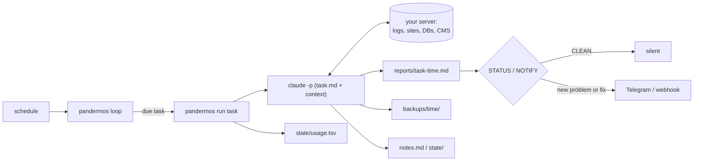

<div align="center">

# Pandermos

**An always-on Claude Code auditor that lives on your server.**
It checks your sites, apps and content on a schedule, fixes what it safely can, and sends you a short message when something needs a human.

[](https://github.com/Oto-Pilot-seo/pandermos/actions/workflows/ci.yml)


[Türkçe](README.tr.md) · [Architecture](docs/ARCHITECTURE.md) · [Writing tasks](docs/WRITING-TASKS.md) · [Safety](docs/SAFETY.md) · [Cost](docs/COST.md)

</div>

---

Monitoring tools tell you *that* something broke. Pandermos goes and looks: it reads the logs, opens the page, downloads the image and looks at it, compares the article with its source, restarts the crashed service, takes a backup before touching anything and writes down what it did.

Under the hood it is deliberately boring: one Bash script, a systemd unit, a folder of Markdown task files and `claude -p`. No daemon framework, no database, no web UI. You can read the whole thing in ten minutes.

```text
$ pandermos status
TASK                   STATUS    LAST-RUN          SCHEDULE
server-health          CLEAN     20261126-0851     every 2 (sonnet, 20m)
website-health         FIXED     20261126-0823     every 4 (sonnet, 30m)
wordpress-news         WARNING   20261126-0905     every 1 (sonnet, 40m)
security               CLEAN     20261126-0331     at 03:30 (sonnet, 30m)
improve                RUNNING   20261126-0400     at 04:00,14:00 (opus, 90m)
```

```text
Telegram  ·  [website-health · FIXED] shop.example.com returned 502 since 08:12:
php8.3-fpm had crashed (OOM, pm.max_children too high for 4 GB). Restarted it,
site answers in 180 ms again. Backup of pool config: backups/20261126-0823/
```

## Why

Pandermos started as the night editor of [pandermos.com](https://www.pandermos.com), a regional news site in Bandırma, Turkey (Pandermos is the city's ancient Greek name). Bots publish dozens of articles a day there, and nobody can check each one. So we put Claude Code on the server with one instruction: look at every new article like an editor would. Is the photo actually the person in the headline? Does the source say what the article says? Is this an old story written as if it were new?

It worked well enough that the same loop now watches every site, app and database on that server, and works on the SaaS that runs on it, twice a day. This repository is that system, with everything specific to us taken out.

## What it does

| | |
|---|---|
| **Scheduled tasks** | Each task is a Markdown file. A plain text schedule says which model runs it, how long it may take and when (`every N` turns, `at 04:00,14:00`, or `manual`). |
| **Fix mode or audit mode** | You decide in `CLAUDE.md` and with sudo rights: report only, fix a whitelist of commands, or full root. |
| **Backups before changes** | The standing rules make the agent copy files, export rows and posts into a dated backup folder *before* editing, and write the path in the report. It never deletes; it moves things aside. |
| **Memory between runs** | `notes.md` (accepted situations, lessons), a state folder per task (e.g. last reviewed post id), and the previous report, which it reads to avoid repeating itself. |
| **Quiet notifications** | Every report ends with `STATUS:` and `NOTIFY:` lines. Clean runs are silent; the same message is never sent twice; you get a daily digest. Telegram and any JSON webhook (Slack, Discord, ntfy, n8n). |
| **Two strikes** | If it failed to fix the same thing twice, the third run escalates to you instead of trying again. |
| **Plan-friendly** | Works with a Claude Pro/Max subscription (`claude setup-token`) or an API key. When the plan's usage limit is hit, the whole loop backs off for an hour. `pandermos usage` shows minutes, tokens and API-equivalent cost per task. |
| **Overlap-safe** | Each task holds a lock, so a manual `pandermos run` and the scheduler never step on each other. |

### Example tasks included

| Task | What it checks |
|---|---|
| [`server-health`](tasks/server-health.md) | disk and inodes, memory and OOM kills, failed units, pm2/docker restart loops, database reachability, backup freshness |
| [`website-health`](tasks/website-health.md) | discovers vhosts, status codes, TTFB, redirects, TLS expiry, error pages, 5xx and fatal errors, upstream processes |
| [`wordpress-news`](tasks/wordpress-news.md) | every new article: looks at the featured image, opens and compares the source, checks the text, fixes or unpublishes |
| [`security`](tasks/security.md) | logins, brute force, new users/keys/ports, secrets served from web roots, PHP in uploads, pending security updates |
| [`app-logs`](tasks/app-logs.md) | groups errors by signature, new vs ongoing vs resolved, restarts crashed processes |
| [`database`](tasks/database.md) | connections, long queries, table growth, vacuum health (PostgreSQL, MySQL, Redis), read-only |
| [`improve`](tasks/improve.md) | picks one problem, writes a failing test, fixes it in a clone and opens a pull request. Never merges, never deploys |

## Quick start

Requirements: a Linux server with systemd, Bash 4+, `jq`, `curl`, Node.js 18+ (for the Claude Code CLI).

```bash
git clone https://github.com/Oto-Pilot-seo/pandermos.git
cd pandermos
sudo ./install.sh                 # audit-ish: no sudo for the agent
```

Get a token for your Claude subscription (on any machine with a browser):

```bash
claude setup-token
```

Then:

```bash
sudo nano /etc/pandermos/secrets.env        # CLAUDE_CODE_OAUTH_TOKEN=..., Telegram or webhook
sudo nano /var/lib/pandermos/CLAUDE.md      # describe your server, pick fix or audit mode
sudo nano /etc/pandermos/schedule           # which tasks, how often
sudo -u pandermos pandermos doctor
sudo -u pandermos pandermos run server-health   # watch one run
sudo -u pandermos pandermos report server-health
sudo systemctl enable --now pandermos
```

Giving the agent the power to fix things:

```bash
# only these commands as root
sudo ./install.sh --sudo-commands "/usr/bin/systemctl restart nginx,/usr/bin/systemctl restart php8.3-fpm,/usr/sbin/nginx -t"

# everything (what we run in production; read docs/SAFETY.md first)
sudo ./install.sh --full-sudo
```

## Commands

```text
pandermos loop                       run the scheduler (systemd runs this)
pandermos run <task> [--model opus] [--timeout 40m] [--note "check the new vhost too"]
pandermos status                     last result of every scheduled task
pandermos usage [days]               runs, minutes, output tokens and API-equivalent cost per task
pandermos report <task>              print the latest report
pandermos notify "text"              send a test notification
pandermos doctor                     check the installation
```

## How a run works



1. The loop reads the schedule and picks the tasks due on this turn.
2. `pandermos run` takes a lock, builds the prompt from the task file plus a context block (time, report path, previous report, state and backup folders) and starts `claude -p` in the working directory, so the standing rules in `CLAUDE.md` are loaded automatically.
3. Claude does the work with the tools you allowed and writes the report.
4. The runner records usage, detects plan limits, parses the last `STATUS:` / `NOTIFY:` lines, notifies if needed and cleans up old reports and backups.

Details in [docs/ARCHITECTURE.md](docs/ARCHITECTURE.md). A full sample report: [docs/example-report.md](docs/example-report.md).

## Writing your own task

A task is a prompt with a job description. Good ones say where things are, what "wrong" looks like, what the agent may fix and what it must only report. Minimal example:

```markdown
Task: keep the shop's product feed healthy.

Feed: https://shop.example.com/feed/google.xml, generated by cron `/etc/cron.d/feed`.
1. Fetch the feed. It must be valid XML, newer than 26 hours, with at least 500 items.
2. Sample 10 items: the price and stock in the feed must match the product page.
3. If the feed is stale, run the generator once (`sudo -u www-data php /var/www/shop/bin/feed.php`) and check again.
Report mismatches with product ids. Never edit prices.
```

Add a line to `/etc/pandermos/schedule`:

```text
shop-feed   sonnet   20m   at 07:00
```

More patterns and anti-patterns: [docs/WRITING-TASKS.md](docs/WRITING-TASKS.md).

## Lessons from running it in production

These are now baked into the default rules and tasks.

- **Make it look.** A photo picked by its file name and caption ended up as the cover of a health story; the banner in the picture said "breeding ram show". Now the rule is: download the image, look at it, compare it with the headline.
- **"Fix" can make things worse.** Asked to replace duplicate photos, the agent reached for generic Wikimedia scenery: an Ankara skyline on a local council story, a circuit board on a phone review. It was technically "unique" and editorially worse. The rule now says: if no relevant image exists, leave it and report. An irrelevant fix is not a fix.
- **Never let it wait in the background.** Early runs started a long job "in the background", said "I'll keep an eye on it" and exited without a report. The rules now forbid background jobs and require a report every time.
- **Old logs lie.** pm2 log lines have no timestamps; the agent raised "API quota exceeded" alarms from week-old lines. Tasks now say: never alarm on a line you cannot date.
- **Two strikes, then a human.** Repeated failed fixes on the same problem used to loop forever. Now the third attempt is a message to you.
- **Backups first, always.** Every change in the reports has a backup path next to it. We have rolled back exactly the way the reports said we could.

## Safety

Pandermos runs an AI agent with real permissions on a real server. That is the point, and also the risk. Start in audit mode, read a week of reports, then widen permissions one command at a time. Use read-only database roles. Keep money, DNS, accounts and credentials out of reach. See [docs/SAFETY.md](docs/SAFETY.md) for the threat model, prompt-injection notes (it reads web pages and user content) and recommended setups.

## Cost

On a Max plan the useful question is "how fast does it eat my quota", not dollars. `pandermos usage 7` prints, per task, the runs, minutes and what the same tokens would cost on the API, so you can tune frequency and models. Our numbers and tuning tips are in [docs/COST.md](docs/COST.md).

## FAQ

**Is this an official Anthropic project?** No. It is a community project that uses the Claude Code CLI.

**Does it need Docker / Kubernetes / a database?** No. Bash, systemd, jq, curl and the Claude CLI.

**Can it run on macOS?** The runner works anywhere Bash and GNU coreutils are available, but `install.sh` and the service file assume Linux with systemd. Use launchd or cron to call `pandermos loop` elsewhere.

**Can I use other models?** Anything `claude --model` accepts. Use `sonnet` for routine checks and `opus` for code changes; `haiku` is fine for very simple checks.

**Can it use MCP servers?** Yes, through `EXTRA_CLAUDE_ARGS="--mcp-config /etc/pandermos/mcp.json"`, and add their tools to `ALLOWED_TOOLS`.

**What stops it from doing something stupid?** Unix permissions first (what the `pandermos` user can actually do), then the allowed tool list, then the standing rules. Rules are guidance; permissions are enforcement. Configure accordingly.

## Contributing

Task files are the most valuable contribution: a good task for Laravel, Django, Ghost, Magento, Postfix, Kubernetes nodes... Open a PR to `tasks/` with a short note on where you ran it. Bug fixes to the runner should come with a test in `tests/run.sh`. See [CONTRIBUTING.md](CONTRIBUTING.md).

## License

MIT. See [LICENSE](LICENSE).
